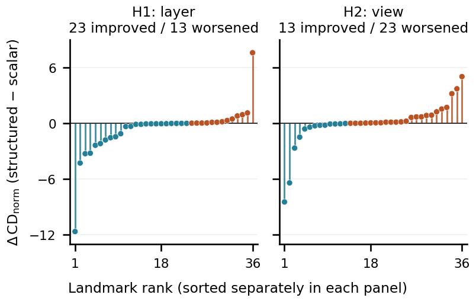

> Historical snapshot from November 16. H3 has since completed. See the [completed Point 3 package](../completed_20261128/README.md) for all three hypotheses, later analyses, and the final-report template. The 79-ID partition is unused by Point 3, but 15 IDs overlap earlier team lists, so the historical team-wide untouched-holdout wording below must not be used as a final claim.

# Completed layer- and view-dependent intervention experiments

H1 (layer-dependent strength) and H2 (view-dependent strength) completed on
November 16, 2026. Each study used the same 54 development landmarks, split into
18 calibration and 36 internal confirmation landmarks, with up to 50 eligible
views per landmark. Both completed all 198 planned scene/condition jobs with
zero recorded failures. Additional reference checks are not included in 198.
The 79-landmark final holdout remains untouched. H3 is unfinished.

**Report:** [seven-page milestone PDF](milestone.pdf)
and [LaTeX source](milestone.tex).

This results-only snapshot is independent of the notebook implementation in
[PR #4](https://github.com/swati1504/ArchWorld/pull/4), available at
[commit 92d9149](https://github.com/tasosger/ArchWorld/tree/92d91497ef74b9298e87b4b921545546c2bfde21).
The runtime study source hash, notebook bundle checksum, and Git commit identify
different artifacts; they must not be treated as interchangeable.
The study source hash is recorded in each `run_study.json`.

## Results

Lower extent-normalized Chamfer distance is better. Each landmark receives
equal weight. H1 and H2 independently produced exactly matching no-intervention
and scalar-control scores on the same 36 confirmation landmarks.

| Condition | Mean normalized CD | Median normalized CD |
| --- | ---: | ---: |
| No intervention | **13.92426** | 7.35234 |
| Calibrated scalar, eta = 1000 | 14.76303 | 6.84867 |
| H1 per-layer, alpha = 0.02 | 14.14062 | **6.57717** |
| H2 per-view, base eta = 100 | 14.76697 | 6.99407 |

| Paired comparison | Mean difference | Median difference | Improved / tied / worsened |
| --- | ---: | ---: | ---: |
| H1 minus scalar | -0.62241 | -0.04327 | 23 / 0 / 13 |
| H2 minus scalar | +0.00394 | +0.05177 | 13 / 0 / 23 |

H1 improves mean error over the calibrated scalar in this cohort, but remains
0.21637 worse than no intervention. H2 remains 0.84272 worse than no intervention
and slightly worse than the scalar. These single-seed, two-candidate studies do
not establish statistical significance or full-benchmark generalization.
They do not show that every adaptive intervention rule will help or fail.



Panels are sorted separately. Matching ranks need not represent the same
landmark; negative values favor the structured rule over the scalar.

Choices were frozen using calibration scores only: scalar eta in {100, 1000},
H1 alpha in {0.01, 0.02}, and H2 base eta in {100, 1000}. The two independently
tuned policies are not an equal-base-strength ablation. The cohort uses 2,622
selected views in total and 1,776 confirmation views. Numerical mask checks do
not replace semantic review of the architectural anchors.

## Reproduce tables and figures

From the repository root, with Python 3.10 or newer:

```bash
python -m pip install matplotlib
python experiments/point3/completed_20261116/evidence/h1_completed_20261116/reproduce_h1_results.py
python experiments/point3/completed_20261116/evidence/h2_completed_20261116/reproduce_h2_results.py
python experiments/point3/completed_20261116/evidence/plot_completed_hypotheses.py
```

These commands use only the committed result snapshots and require no GPU,
model weights, Hugging Face token, Google Drive access, or dataset download.
They verify completion, frozen selection hashes, calibration-only choices,
disjoint splits, condition totals, and paired-table consistency. The combined
script checks exact H1/H2 control agreement and regenerates the figure above.
The scripts write derived statistics under `evidence/` and plots under `figures/`;
the downloaded result CSV/JSON files remain unchanged.

Raw snapshots are under [H1 evidence](evidence/h1_completed_20261116/)
and [H2 evidence](evidence/h2_completed_20261116/). Each has a README and a
`drive_provenance.json` manifest with canonical source links and SHA-256 hashes.
The `.gitattributes` file preserves these evidence bytes across Windows and Unix
checkouts. Drive links are provenance references; the public snapshots suffice
for reproducing the reported statistics.

## Build the report

With a LaTeX installation providing the standard ACM dependencies:

```bash
cd experiments/point3/completed_20261116
pdflatex -interaction=nonstopmode -halt-on-error milestone.tex
bibtex milestone
pdflatex -interaction=nonstopmode -halt-on-error milestone.tex
pdflatex -interaction=nonstopmode -halt-on-error milestone.tex
```

The report includes all three members' contributions, names and NetIDs, H1/H2
results, limitations, ownership, and repository links. H3 remains explicitly
unfinished. The existing baseline and scene-selection analyses are documented
in the repository's `eric/`, `pass1_signals/`, and `swati/` materials.

ACM template version 2.20 is included with its original source and
[LPPL license](LICENSE.acmart). The paper photographs and original ArchAttend
reconstructions are reproduced from Kriplani et al., Figures 2 and 7, under
CC BY 4.0, with attribution in the report. They are clearly labeled as prior
work. The H1/H2 plot is generated from the experiment data committed here.

## Ownership

Anastasios Gerasis owns the structured-intervention implementation, subset audit,
mask workflow, experiments, and H1/H2 analysis. Eric Lu owns the baseline and
Pass-1 feature study. Swati Parida owns scene-level adaptive strength selection.
The full allocation is recorded in the milestone report.
