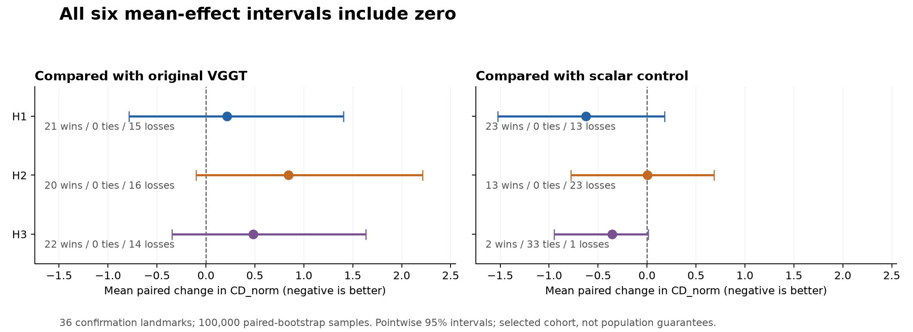
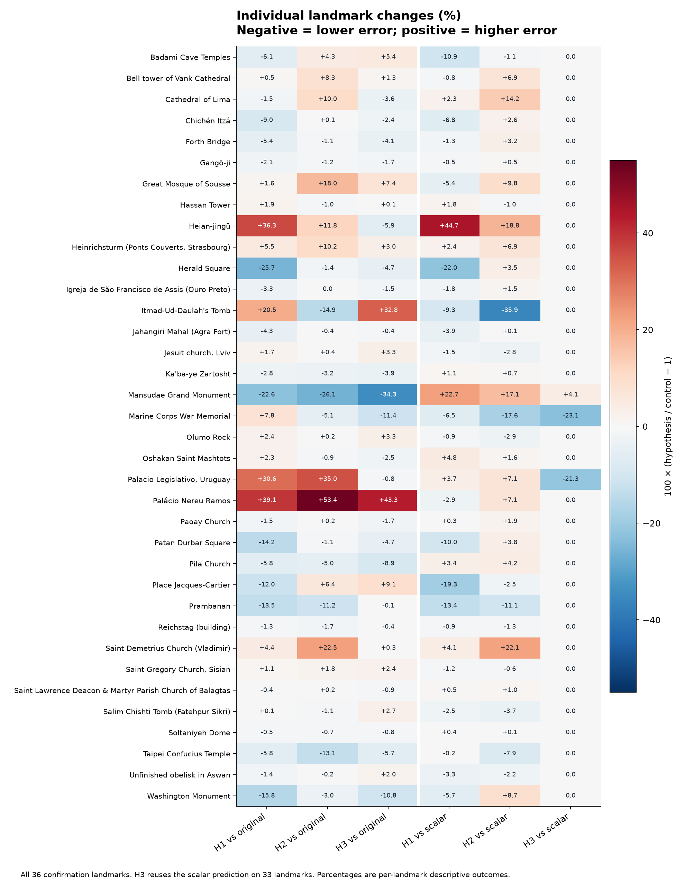
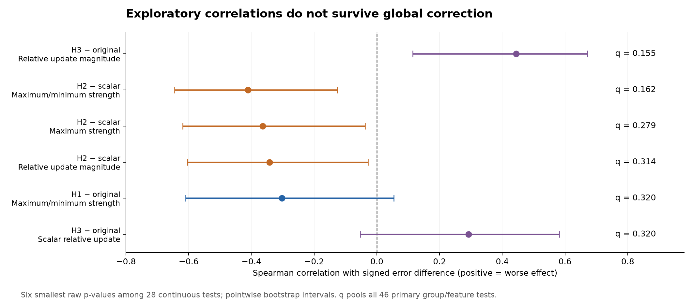
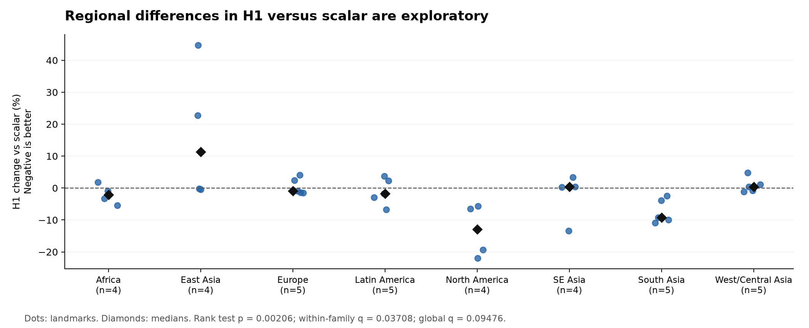

# Point 3: extended results, robustness and correlations

The additional analysis identifies consistent local patterns within the observed landmarks, but the study does not yet establish a reliable rule for predicting gains. H1 is the most promising incremental improvement over the scalar control. H2 has mixed results, and H3 changes too few predictions to support a broad claim about anchor-dependent selection.

Three parallel analyses covered paired effects, categorical groups, and continuous correlations. A separate review independently reproduced all 108 method–landmark joins, 28 primary rank correlations and 18 categorical test statistics. All 35 archived evidence files passed their SHA-256 checks. This work analyzes saved results; it adds no model runs and uses no final-holdout outcomes.

## 1. Overall performance and uncertainty

The independent unit is a landmark: **36 confirmation landmarks**, using settings frozen on **18 separate calibration landmarks**. The 1,776 confirmation input views are not additional independent observations. Scores below are whole-landmark normalized Chamfer error (`CD_norm`), where lower is better.

| Method | Mean error | Change vs original | Change vs scalar | Wins vs original | Wins vs scalar |
|---|---:|---:|---:|---:|---:|
| Original VGGT | 13.9243 | — | — | — | — |
| Scalar control | 14.7630 | +6.02% | — | — | — |
| H1 | 14.1406 | +1.55% | −4.22% | 21/36 | 23/36 |
| H2 | 14.7670 | +6.05% | +0.03% | 20/36 | 13/36 |
| H3 | 14.4077 | +3.47% | −2.41% | 22/36 | 2 wins, 33 ties, 1 loss |

Changes in this table are percentages of mean errors, not averages of individual percentage changes. Positive means worse. All three methods have more original-model wins than losses, yet their regressions are large enough to produce worse mean error.

All six pointwise 95% paired-bootstrap intervals for mean differences include zero. None of the six exact win/loss sign tests survives Holm correction. This does **not** establish equivalence or prove that steering has no effect. Resampling the deliberately selected confirmation set describes sensitivity within that collection; it does not guarantee confidence coverage for the entire 396-landmark dataset.

H1 versus scalar is the strongest overall lead: mean difference **−0.6224**, bootstrap interval **[−1.5247, +0.1813]**, with 23 wins. Its mean remains favorable after omitting any single landmark, ranging from −0.8575 to −0.3069. That robustness is useful evidence, while the interval still limits a superiority claim.

[Full paired estimates](effects/paired_effects.csv) · [Effects and methods](effects/findings.md)

## 2. Large regressions explain the averages

**Palácio Nereu Ramos is the largest regression against original VGGT for all three hypotheses.** Its increases in error are +14.3823 for H1, +19.6498 for H2 and +15.9304 for H3.

Removing this landmark changes H1’s mean difference from +0.2164 to −0.1884. H2 and H3 remain worse than original on average after every possible single-landmark omission. The landmark stays in all official results; removing it is an influence diagnostic, not a revised benchmark score.

The distinction between absolute and relative summaries also matters. H1 is +1.55% worse when comparing mean errors, but only +0.03% worse when averaging each landmark’s percentage change. H3’s corresponding values are +3.47% and +0.15%. These answer different questions and cannot be exchanged to obtain a more favorable headline.

[Every landmark’s contribution and leave-one-out result](effects/landmark_influence.csv)

## 3. Anchor-dependent patterns

The confirmation set has **23 executed anchor labels, including 17 singletons**. Repeated groups are arch (8), facade (3), bridge (2), pillar (2), statue (2) and window (2). Most apparent anchor effects therefore describe individual landmarks rather than general properties of an anchor class.

**H1 and facade is a useful descriptive success pattern.** Herald Square, Jahangiri Mahal (Agra Fort) and Patan Durbar Square all improve against both controls. Their group-mean error decreases by **16.80% versus original** and **12.83% versus scalar**. The direction remains favorable after removing any one case, but three examples are insufficient to establish a general facade rule.

**H2 and arch is a repeated failure pattern.** Across eight arch-anchor landmarks, mean error is **8.73% worse than original** and **7.37% worse than scalar**, with only 2/8 and 1/8 wins respectively. H2 also improves all three facade cases versus original but loses all three to scalar. The comparator changes the interpretation.

The anchors identify where steering was applied. These are whole-landmark errors, not errors measured exclusively inside the facade, arch, statue or another masked region. Numerical checks do not establish segmentation quality; a complete manual mask audit remains separate work.

Two supplied labels differ from the already-frozen executed plan: Forth Bridge uses `bridge` where the supplied label was missing; Washington Monument uses `obelisk` where the supplied label was `altar`. This analysis preserves and documents those existing choices.

[All anchor, region and building-type summaries](groups/group_effects.csv) · [Group analysis](groups/findings.md)

## 4. What H3 actually changed

| Policy behavior on confirmation | Landmarks | Relation to scalar |
|---|---:|---|
| Unsupported anchor fallback | 19 | Identical prediction |
| Supported anchor selecting the same strength | 14 | Identical prediction |
| Supported anchor selecting a different strength | 3 | Two improvements, one regression |

The three changed cases use eta=100 instead of the global eta=1000:

| Landmark | Anchor | H3 minus original | H3 minus scalar |
|---|---|---:|---:|
| Mansudae Grand Monument | statue | −2.67575 | +0.20137 |
| Marine Corps War Memorial | statue | −3.59097 | −8.41346 |
| Palacio Legislativo, Uruguay | column | −0.14015 | −4.57996 |

All three beat original VGGT. Their group-mean error is **11.34% lower than original** and **20.34% lower than scalar**, but this is a three-landmark subgroup. The result suggests that the learned policy had limited opportunity to differ from scalar, rather than demonstrating that anchor-dependent strengths generally work or generally fail.

[H3 policy decomposition](groups/h3_rule_groups.csv)

## 5. Correlations and categorical associations

We tested 28 primary continuous-feature associations and 18 categorical associations. The continuous features cover physical extent, variable strength coefficients and actual relative-update magnitude. Categorical fields are executed anchor, region and building type. No favorable regrouping or outcome-based cutoff was introduced.

**No association survives correction across all 46 primary exploratory tests.** The minimum global Benjamini–Hochberg q value is **0.09476**, and none passes global Holm correction either. Within the smaller categorical family, one regional result passes correction; the broader result is the appropriate caution when interpreting the combined search.

| Exploratory pattern | Statistic | Raw p | Global q across 46 |
|---|---:|---:|---:|
| Region and H1 versus scalar | Rank-based omnibus test | 0.00206 | 0.09476 |
| H3 update magnitude and difference from original | Spearman rho +0.445 | 0.00672 | 0.15456 |
| H2 coefficient spread and difference from scalar | Spearman rho −0.411 | 0.01412 | 0.16238 |

Signed differences are hypothesis minus comparator. A positive correlation means larger feature values accompany worse effects; a negative correlation means they accompany better effects.

The H3 update correlation remains positive after every single-landmark omission. However, 33/36 H3 predictions reuse scalar, so this mostly describes scalar-steering behavior rather than the incremental effect of anchor selection. The H2 coefficient-spread correlation also keeps its sign under every omission. These are plausible leads for independent study, not validated selection rules. H2’s ratio has 21 exact ties at its bound of four; the calculation uses average ranks.

The H1 regional association is specific to the scalar comparison. The equivalent original-model regional test has p=0.41068. North America has 4/4 scalar wins and South Asia 5/5; SE Asia has a favorable group mean but only 1/4 scalar wins because Prambanan dominates the improvement. Region, anchor, architecture and difficulty overlap, so the analysis cannot attribute the differences causally to geography.

Physical extent supplies no supported size-based rule. No building-type or anchor omnibus comparison survives even the smaller categorical-family correction. The full result table includes nonsignificant tests, not only the strongest associations.

[All 46 primary exploratory tests](all_exploratory_primary_tests.csv) · [Continuous correlations](correlations/primary_correlations.csv) · [Correlation methods and limitations](correlations/findings.md)

## 6. What the diagnostics can and cannot explain

- Every selected run accepted 24 layers and recorded zero clipped view steps. These constant quantities cannot explain the variation across landmarks.
- H1’s mean applied relative update is effectively fixed at 0.02. Its tiny numerical fluctuations were excluded; larger raw coefficients do not necessarily mean larger relative updates under this normalization.
- View count is 50 for 35 landmarks and 26 for one. A correlation would largely describe that single exception, so it was excluded. Per-scene image resolution and duplicate statistics were unavailable in the supplied analysis tables.
- A correlation between original error and improvement shares an error term mathematically. Such diagnostics are separate from the inferential feature search and cannot prove that harder landmarks benefit more.
- For H3 versus scalar, roughly 4.0–4.6% of bootstrap samples contain only ties, making correlation undefined. Those stored correlation intervals condition on a defined statistic; they are not ordinary unconditional 95% intervals.
- H2 uses base eta=100, while the main scalar comparator uses eta=1000. This comparison cannot isolate the effect of view weighting from the effect of different steering strength. A matched scalar-eta100 comparison is incomplete on confirmation.
- Rank/permutation assumptions and nonrandom subset selection limit population interpretations. The six method/control sign tests form a separate primary comparison family. The 28 log-ratio sensitivity correlations are reported separately and do not produce discoveries after their stated correction.

## 7. Do the methods help the same landmarks?

| Criterion | At least one hypothesis wins | All three win | None wins |
|---|---:|---:|---:|
| Compared with original | 28/36 | 14/36 | 8/36 |
| Compared with scalar | 25/36 | 1/36 | 11/36 |
| Compared with both controls | 19/36 | 0/36 | 17/36 |

There are complementary successes, but these counts do not evaluate an adaptive selector. Choosing whichever method wins after observing ground-truth errors would leak the evaluation outcome. The analysis does not claim an achievable 28/36 or 19/36 selection policy.

[Overlap audit](audit/findings.md) · [Every landmark’s win pattern](audit/win_patterns.csv)

## 8. Interpretation for the final report

The report can now explain why modest improvements on many landmarks coexist with worse average error: regressions are uneven and sometimes large. H1 shows the strongest consistent advantage over the scalar control, including the three facade examples. H2’s results are mixed and its comparator does not isolate view weighting. H3’s incremental effect is concentrated in only three changed predictions. Exploratory correlations identify ideas for future evaluation but provide no statistically established selection rule after broad correction.

Keep the original aggregate results, the verified reconstruction figures, these subgroup descriptions and the uncertainty analysis together. Do not delete difficult cases or retune from the confirmation patterns. A frozen final-holdout evaluation would answer the generalization question. If the specific future claim is that view weighting itself helps, a matched-strength H2 ablation would answer a different, more focused question.

## Reproduction and artifacts

The included `sources/` snapshot contains the frozen evidence with its original checksum manifest. `python run_all.py` runs the CPU analyses and regenerates tables/plots. NumPy and pandas are required; Matplotlib is needed for figures. No Drive mount, GPU, model downloads or Colab connection is involved. Exact analysis settings, source hashes and resampling seeds are saved in the per-analysis JSON files. `versions.json` records the local software used.

The full dataset contains 396 landmarks: 317 in the training partition and 79 in a separate evaluation partition unused by Point 3. However, 15 of those IDs overlap earlier team development/test lists, so the partition is not established as untouched across the team. The selected 54 training landmarks split into 18 calibration and 36 confirmation cases. All counts and joins were audited independently. Existing model outputs and prior reports remain unchanged.
