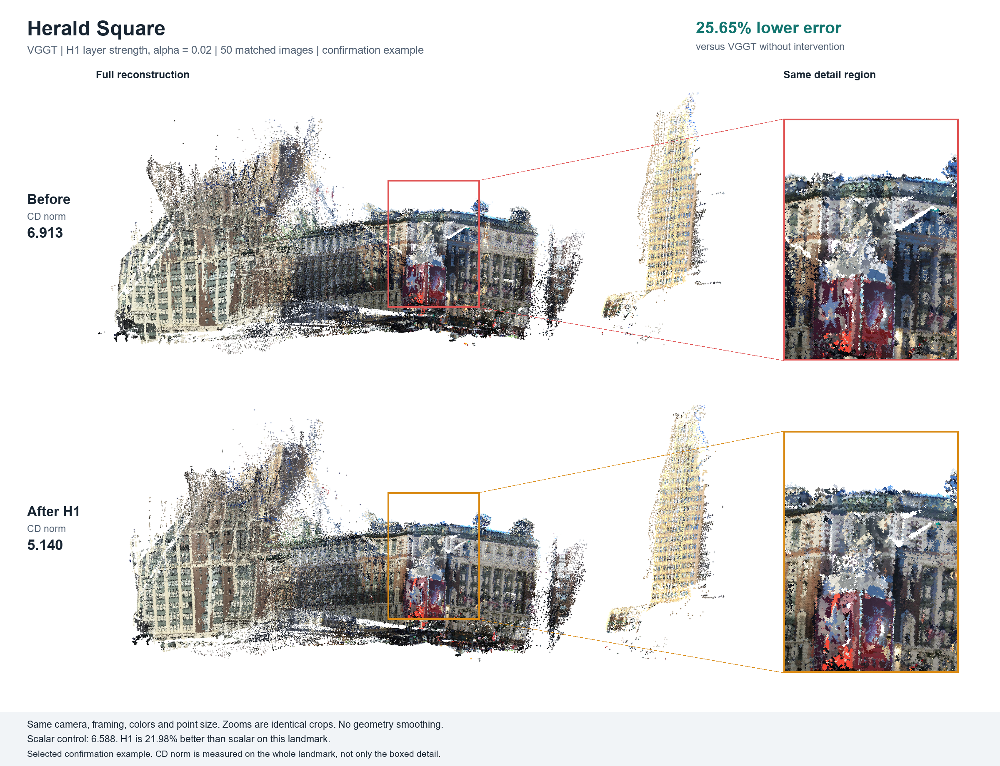
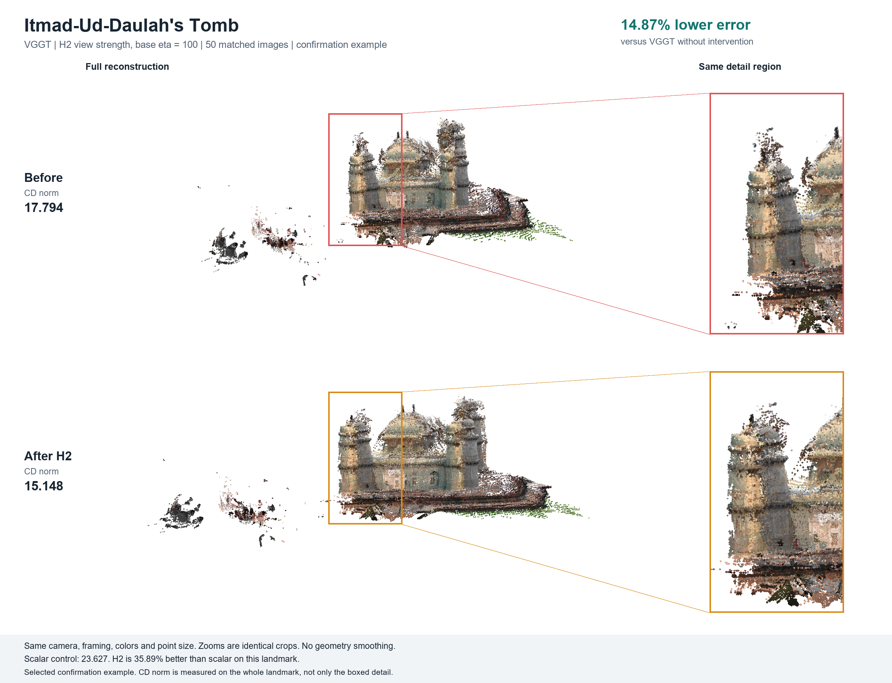
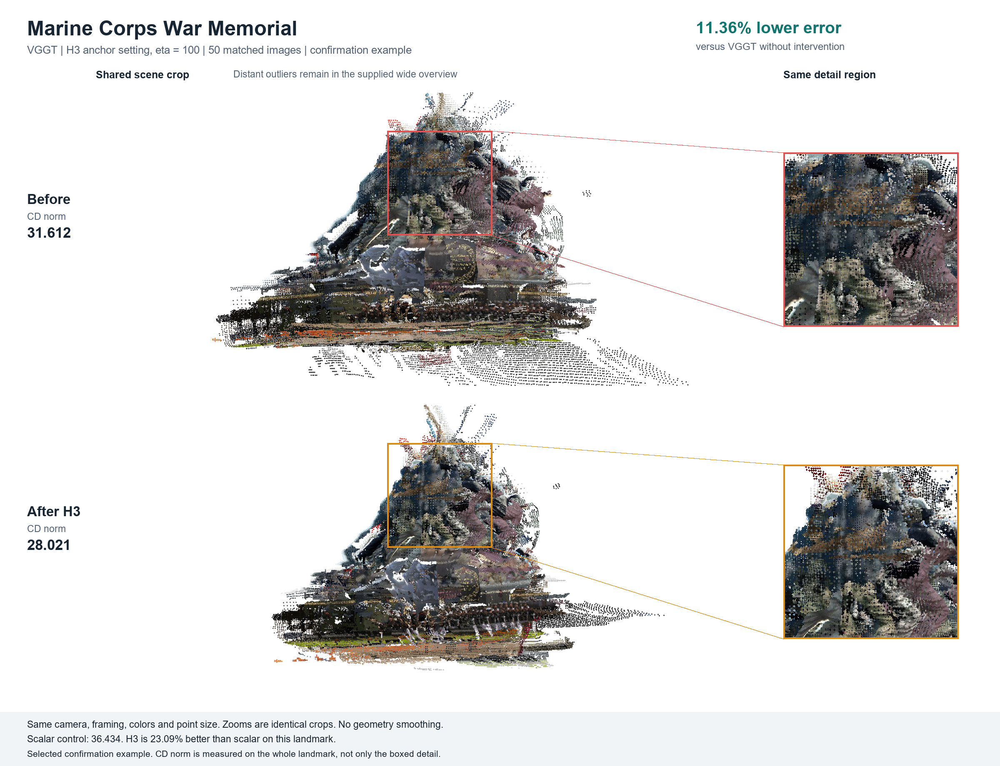

# Reconstruction examples for H1, H2 and H3

Each hypothesis has a confirmation landmark where its frozen setting beats both unmodified VGGT and the calibrated global scalar control. All three reconstruction reruns passed exact prediction-hash checks and matching-metric checks against the saved experiments. The figures display actual evaluated point clouds.

These are **success cases selected after seeing the results**, not evidence of an overall improvement. None of the hypotheses lowers mean error relative to unmodified VGGT across all 36 confirmation landmarks.

## Measured results

| Hypothesis | Landmark | Steering anchor | Original VGGT | Scalar control | Hypothesis | Lower error vs original | Lower error vs scalar |
|---|---|---|---:|---:|---:|---:|---:|
| H1 | Herald Square | facade | 6.91342 | 6.58839 | **5.14010** | **25.65%** | **21.98%** |
| H2 | Itmad-Ud-Daulah's Tomb | railing | 17.79411 | 23.62690 | **15.14755** | **14.87%** | **35.89%** |
| H3 | Marine Corps War Memorial | statue | 31.61162 | 36.43411 | **28.02065** | **11.36%** | **23.09%** |

Lower normalized Chamfer error (`CD_norm`) is better. Each landmark uses the same 50 selected images and saved anchor masks across its three conditions. Percentage reduction is `100 × (control − hypothesis) / control`.

The score measures **the whole landmark**, not only the facade, railing, statue, or boxed detail. The anchor is the region used to steer the network. A visual crop alone does not establish a separate numerical improvement for that region.

[View the verified figures in the report appendix](../report/main.pdf).

## Verified figures

### H1: Herald Square

The frozen `layer_alpha0.02` setting reduces whole-landmark error by **25.65%** versus unmodified VGGT and **21.98%** versus the scalar control. Both rows use the same camera, framing, point size and detail crop. The selected region is a visual detail; it need not coincide with the steering anchor, and no separate region-specific error is reported.

[Reference point cloud](figures/H1/reference.png) · [Scalar-control point cloud](figures/H1/scalar_eta1000.png)

### H2: Itmad-Ud-Daulah's Tomb

The frozen `view_eta100` setting reduces whole-landmark error by **14.87%** versus unmodified VGGT and **35.89%** versus the scalar control. Both rows use the same camera, framing, point size and detail crop. The selected region is a visual detail; it need not coincide with the steering anchor, and no separate region-specific error is reported.

[Reference point cloud](figures/H2/reference.png) · [Scalar-control point cloud](figures/H2/scalar_eta1000.png)

### H3: Marine Corps War Memorial

The frozen `scalar_eta100` setting reduces whole-landmark error by **11.36%** versus unmodified VGGT and **23.09%** versus the scalar control. Both rows use the same camera, framing, point size and detail crop. The selected region is a visual detail; it need not coincide with the steering anchor, and no separate region-specific error is reported.

[Reference point cloud](figures/H3/reference.png) · [Scalar-control point cloud](figures/H3/scalar_eta1000.png)

H3 uses a tighter shared scene crop because distant outliers compress the statue in the overview. The crop contains 99.13% of displayed baseline points and 99.26% of displayed H3 points. Outliers still contribute to the reported full-cloud metric. [Wider overview](figures/H3/wide_overview/before_after.png).

## What the examples establish

**H1 — Herald Square.** The frozen layer-dependent setting `layer_alpha0.02` improves over both controls. This confirmation example supersedes Westminster as the primary H1 illustration: Westminster was a calibration example that beat unmodified VGGT but was slightly worse than its scalar control.

**H2 — Itmad-Ud-Daulah's Tomb.** The frozen view-dependent setting is `view_eta100`, with base strength 100; the global scalar comparator uses 1000. The steering anchor is railing, whereas the enlargement shows the tower and adjacent roof edge. This does not imply that only the anchor region changed. The six-view mask preview broadly highlights railing/parapet regions where visible; it is not a manual audit of all 50 masks.

**H3 — Marine Corps War Memorial.** Calibration selected `scalar_eta100` for the statue anchor rather than the global `scalar_eta1000`. This landmark therefore has a distinct H3 prediction. Across the 36 confirmation landmarks, 33 H3 predictions match the scalar control exactly. Those reused scalar predictions cannot be counted as additional H3-specific gains.

Visible distortions, missing structure and scattered points remain in the reconstructions. Lower whole-landmark error does not mean that every structure improved, or that each enlarged detail is quantitatively better.

## Selection and scope

For each hypothesis, we filtered the 36 confirmation landmarks to cases beating both controls, then chose the largest percentage reduction relative to original VGGT. There were 14 qualifying H1 cases, eight H2 cases and two H3 cases. The selections were cross-checked against the paired analysis table and original scene results. Model settings remained frozen from calibration; selecting a figure did not retune them.

These examples are exploratory illustrations of where steering helped. They do not replace the aggregate results. The separate 79-landmark evaluation partition is unused by Point 3, but 15 IDs overlap earlier team development/test lists, so it is not established as untouched team-wide.

## Reproduction and rendering

The [combined export notebook](https://drive.google.com/file/d/1x3-qpRi8FAu0tTbgZe6ndHwlgeBjNSuY/view?usp=drivesdk) exported the three cases sequentially on an L4. The exporter read the completed study and wrote to separate qualitative directories.

It checked the source bundle and code identity, frozen settings, ordered input images and file hashes, saved SAM mask hashes, original condition order, prediction hashes, and reconstruction metrics. All nine conditions passed. Exporting did not modify the original study results.

Figures follow the before/after and matched-detail layout of [Figure 7 in the original paper](https://arxiv.org/html/2610.22514v1#S5.F7). They use actual evaluated, GT-aligned points with their associated input RGB colors. A private generator with seed 1729 samples up to one million points per cloud for display; the reported metrics use the full evaluated clouds.

Within each landmark, all conditions share the same camera orientation, scale, framing, point size, and detail crop. Framing uses joint projected quantile bounds of the three predictions and the reference, with padding: 0.001/0.999 for H1/H2 and the supplied H3 wide overview; 0.01/0.99 for the tighter H3 scene crop. Framing never changes the reported full-cloud metrics. Camera orientations were chosen from reference-cloud previews; common crops were adjusted for legibility. No geometry smoothing, retouching, or generated reconstruction imagery was used. Separate reference and scalar-control renders use the identical camera and framing. Exact camera matrices, bounds, crop coordinates, in-frame fractions and source checksums are recorded in each figure's `render_provenance.json`.

The three figures and combined PDF were visually inspected. This package includes figure PNGs, metric and hash-verification records, and rendering provenance. Figure PDFs are in `../report/figures/`. The `geometry/` folders contain metadata only. Raw point clouds, photographs, masks, and model weights are not redistributed here. Re-rendering requires the separately retained point-cloud exports. CPU verification checks the saved records and figure hashes without those large assets.
